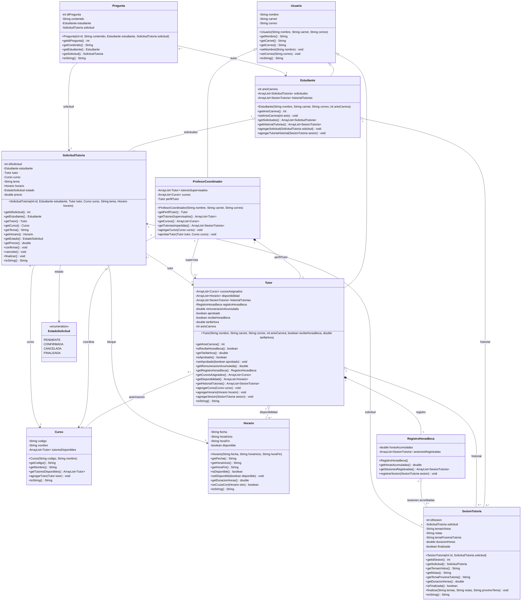
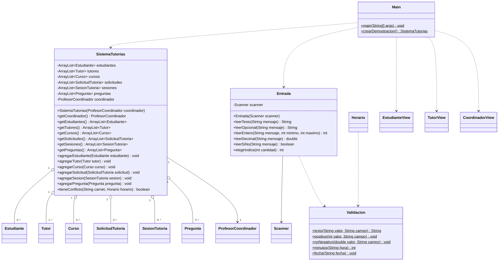

# UML de la implementacion

Atributos y metodos declarados en las 21 clases o enumeraciones de `src/`. Se incluyen constructores y metodos privados; los miembros heredados no se repiten. Los tres diagramas son vistas del mismo sistema. `+` indica public, `-` private; los miembros estaticos se marcan con `$` en Mermaid. Los tipos ArrayList se muestran con su tipo de objeto.

Las relaciones se indican por referencias y listas existentes. El rombo lleno representa composicion; el vacio, agregacion. Las flechas discontinuas representan dependencias. Los objetos se comparten por referencia: una sesion aparece en ambos historiales sin duplicarse. No se usan interfaces ni herencia multiple.

## Modelo

## Controladores y vistas

```mermaid
classDiagram
    class EstudianteController {
        -SistemaTutorias sistema
        +EstudianteController(SistemaTutorias sistema)
        +consultarCursos() ArrayList~Curso~
        +consultarTutores(Curso curso) ArrayList~Tutor~
        +consultarHorarios(Tutor tutor) ArrayList~Horario~
        +consultarPrecio(Tutor tutor, Curso curso, Horario horario) double
        +solicitarTutoria(Estudiante estudiante, Curso curso, Tutor tutor, String tema, Horario horario) SolicitudTutoria
        +consultarSolicitudes(Estudiante estudiante) ArrayList~SolicitudTutoria~
        +consultarHistorial(Estudiante estudiante) ArrayList~SesionTutoria~
        +cancelarTutoria(Estudiante estudiante, SolicitudTutoria solicitud) void
        +registrarPregunta(Estudiante estudiante, SolicitudTutoria solicitud, String contenido) Pregunta
        +consultarPreguntas(Estudiante estudiante) ArrayList~Pregunta~
        -verificarSolicitud(Estudiante estudiante, SolicitudTutoria solicitud) void
    }
    class TutorController {
        -SistemaTutorias sistema
        +TutorController(SistemaTutorias sistema)
        +consultarCursosAsignados(Tutor tutor) ArrayList~Curso~
        +consultarSolicitudes(Tutor tutor) ArrayList~SolicitudTutoria~
        +aceptarTutoria(Tutor tutor, SolicitudTutoria solicitud) SesionTutoria
        +cancelarTutoria(Tutor tutor, SolicitudTutoria solicitud) void
        +consultarSesionesPendientes(Tutor tutor) ArrayList~SesionTutoria~
        +finalizarSesion(Tutor tutor, SesionTutoria sesion, String temas, String notas, String proximo) void
        +consultarHistorial(Tutor tutor) ArrayList~SesionTutoria~
        +consultarRemuneracion(Tutor tutor) double
        +consultarHorasBeca(Tutor tutor) double
        +consultarPago(Tutor tutor) double
        +consultarPreguntas(Tutor tutor) ArrayList~Pregunta~
        +agregarHorario(Tutor tutor, String fecha, String inicio, String fin) void
        -verificarSolicitud(Tutor tutor, SolicitudTutoria solicitud) void
    }
    class CoordinadorController {
        -SistemaTutorias sistema
        +CoordinadorController(SistemaTutorias sistema)
        +consultarTutores() ArrayList~Tutor~
        +consultarCursos() ArrayList~Curso~
        +consultarEstudiantes() ArrayList~Estudiante~
        +consultarEstudiantesConTutorias() ArrayList~Estudiante~
        +consultarProgreso(Estudiante estudiante) ArrayList~SesionTutoria~
        +consultarSolicitudes() ArrayList~SolicitudTutoria~
        +consultarHistorial() ArrayList~SesionTutoria~
        +aprobarTutor(Tutor tutor, Curso curso) void
        +registrarEstudiante(String nombre, String carnet, String correo, int anio) void
        +registrarTutor(String nombre, String carnet, String correo, int anio, boolean beca, double tarifa) void
        +registrarCurso(String codigo, String nombre) void
        +buscarTutorAlternativo(Curso curso, Estudiante estudiante) Tutor
        +consultarDemanda() String
    }
    class EstudianteView {
        -EstudianteController controlador
        -CoordinadorController coordinadorController
        -Entrada entrada
        -Estudiante estudiante
        +EstudianteView(EstudianteController controlador, CoordinadorController coordinadorController, Entrada entrada, Estudiante estudiante)
        +mostrarMenu() void
        -elegirCurso() Curso
        -consultarOferta() void
        -solicitarTutoria() void
        -elegirSolicitud() SolicitudTutoria
        +mostrarSolicitudes(ArrayList~SolicitudTutoria~ solicitudes) void
        +mostrarHistorial(ArrayList~SesionTutoria~ sesiones) void
    }
    class TutorView {
        -TutorController controlador
        -Entrada entrada
        -Tutor tutor
        +TutorView(TutorController controlador, Entrada entrada, Tutor tutor)
        +mostrarMenu() void
        -elegirSolicitud() SolicitudTutoria
        -finalizarSesion() void
        +mostrarSolicitudes(ArrayList~SolicitudTutoria~ solicitudes) void
        +mostrarHistorial(ArrayList~SesionTutoria~ sesiones) void
    }
    class CoordinadorView {
        -CoordinadorController controlador
        -TutorController tutorController
        -ProfesorCoordinador coordinador
        -Entrada entrada
        +CoordinadorView(CoordinadorController controlador, TutorController tutorController, ProfesorCoordinador coordinador, Entrada entrada)
        +mostrarMenu() void
        -aprobarTutor() void
        -registrarTutor() void
        +mostrarEstudiantes(ArrayList~Estudiante~ estudiantes) void
        +mostrarHistorial(ArrayList~SesionTutoria~ sesiones) void
    }
    EstudianteController --> SistemaTutorias
    TutorController --> SistemaTutorias
    CoordinadorController --> SistemaTutorias
    EstudianteView --> EstudianteController
    EstudianteView --> CoordinadorController
    TutorView --> TutorController
    CoordinadorView --> CoordinadorController
    CoordinadorView --> TutorController
    EstudianteView --> Entrada
    TutorView --> Entrada
    CoordinadorView --> Entrada
    EstudianteView --> Estudiante
    TutorView --> Tutor
    CoordinadorView --> ProfesorCoordinador
    CoordinadorView ..> TutorView : usa para el profesor
```

## Datos compartidos, entrada y arranque

