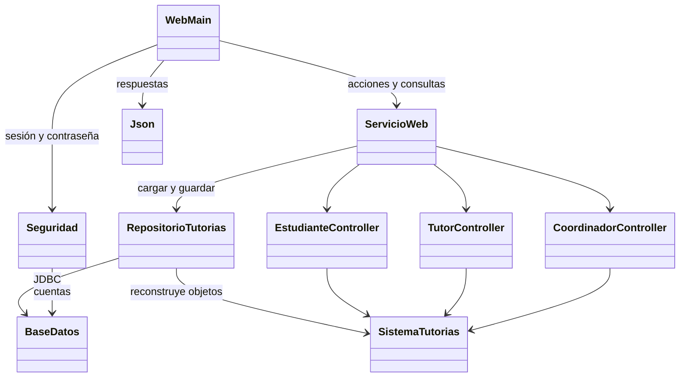

# Arquitectura de la versión web

El UML del dominio está en `UML.md`. Esta ampliación conserva las entidades y controladores, sustituye las vistas de consola en el navegador e incorpora HTTP, cuentas y persistencia.

`web/app.js` envía formularios a `/api/accion/{accion}` y obtiene el estado autorizado desde `/api/estado`. `WebMain` comprueba sesión y CSRF. `ServicioWeb` comprueba rol, resuelve IDs y llama a los controladores. `RepositorioTutorias` reconstruye el grafo de objetos desde tablas y guarda cada modificación en una transacción con control de revisión. Las solicitudes de modificación se serializan dentro de una instancia del servicio; la revisión protege contra sobrescrituras entre procesos.

Los record `Seguridad.Cuenta`, `Seguridad.Identidad` y `RepositorioTutorias.Estado` transportan credenciales protegidas, identidad y revisión respectivamente. `WebMain.Sesion` conserva identidad, token CSRF y expiración. Las sesiones del navegador están en memoria; los datos del proyecto y hashes de contraseña se guardan en SQL.

Se añadieron JDBC, colecciones Map, servidor HTTP del JDK, records, JavaScript y APIs de criptografía. Son conceptos adicionales a la tercera entrega. El equipo debe poder explicarlos durante la presentación. `SolicitudTutoria.restaurarPrecio` permite recuperar el precio histórico sin recalcularlo a una tarifa diferente.
